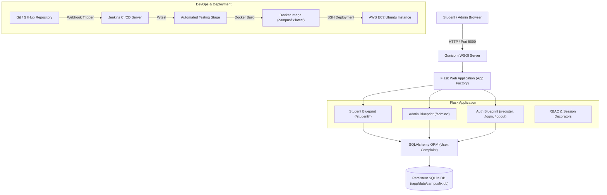
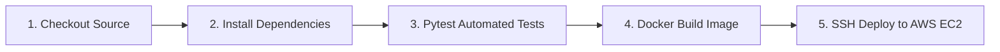

# 🏢 CampusFix – Campus Complaint & Maintenance Management System

> **A production-grade, full-stack web application with Automated CI/CD, Containerization, and Cloud Deployment.**  
> Designed as a College Major Project demonstrating Frontend Engineering, Backend Development, Relational Database Modeling, Docker Containerization, Jenkins CI/CD Automation, and AWS EC2 Cloud Infrastructure.

---

## 📌 Table of Contents
1. [Project Overview](#-project-overview)
2. [Problem Statement & Objectives](#-problem-statement--objectives)
3. [Key Features](#-key-features)
4. [Technology Stack](#-technology-stack)
5. [System Architecture](#-system-architecture)
6. [Database Schema](#-database-schema)
7. [Project Folder Structure](#-project-folder-structure)
8. [Local Installation & Setup](#-local-installation--setup)
9. [Running with Docker & Docker Compose](#-running-with-docker--docker-compose)
10. [Automated Testing (Pytest)](#-automated-testing-pytest)
11. [Jenkins CI/CD Pipeline Setup](#-jenkins-cicd-pipeline-setup)
12. [AWS EC2 Deployment Guide](#-aws-ec2-deployment-guide)
13. [Default Credentials & Demo Accounts](#-default-credentials--demo-accounts)
14. [Viva & Project Defense Talking Points](#-viva--project-defense-talking-points)

---

## 🌟 Project Overview

**CampusFix** is a centralized, digital maintenance and complaint management platform designed for universities and colleges. It bridges the communication gap between students and campus facility administration, replacing disorganized paper registers, WhatsApp complaints, and delayed emails with a transparent, role-based ticketing system.

Students can quickly log maintenance issues (such as broken fans, faulty projectors, leaking washroom taps, Wi-Fi outages, or damaged furniture) and track their real-time resolution status. Administrators have an executive operations dashboard with interactive visual analytics, multi-criteria filtering, and one-click status/priority updates.

---

## 🎯 Problem Statement & Objectives

### Problem Statement
In traditional college environments, infrastructure maintenance requests suffer from:
- Lack of accountability and delayed resolution timelines.
- Misplaced paper complaint registers in hostels and departments.
- Absence of priority triage for urgent/hazardous safety issues.
- Zero visibility for students into whether their complaint was reviewed or dispatched.

### Objectives
1. **Digitize Campus Maintenance**: Provide a single, intuitive portal for students to lodge complaints.
2. **Role-Based Access Control (RBAC)**: Ensure strict data isolation between students and administrative staff.
3. **Operational Visibility**: Offer real-time tracking badges (`Pending` ➔ `In Progress` ➔ `Resolved`).
4. **DevOps Automation**: Enforce software engineering best practices with unit testing, Docker containerization, Jenkins CI/CD pipeline automation, and AWS EC2 hosting.

---

## 🚀 Key Features

### 👨‍🎓 1. Student Portal
- **Secure Registration & Auth**: Session-based login with Werkzeug password hashing.
- **Personalized Dashboard**: Live statistics showing Total Reported, Pending, In Progress, and Resolved complaints.
- **1-Click Complaint Intake**:
  - Title & Category selection (*Electrical, Plumbing, Wi-Fi & Internet, Furniture, Cleanliness, Classroom Equipment, Water Supply, Other*).
  - Specific Campus Location input (e.g. *CS Block, Room 204*).
  - Detailed issue description with urgency level.
- **My Complaints & Filtering**: Search by keyword, filter by category or status.
- **Resolution Timeline Tracker**: Visual 3-stage progress indicator (*Logged ➔ Under Maintenance ➔ Resolved*).

### 🛠️ 2. Administrator Portal
- **Executive Operations Dashboard**: High-level KPI cards for total complaints, pending review, active maintenance, resolved cases, and high-priority alerts.
- **Interactive Visual Charts (Chart.js)**:
  - Resolution Status Ratio (Doughnut Chart)
  - Complaints by Facility Category (Bar Chart)
- **Centralized Complaints Manager**:
  - Multi-parameter search & filtering (search student name/email/title, filter by status, priority, category).
  - Inline one-click status updater (`Pending`, `In Progress`, `Resolved`).
  - Priority triage (`Low`, `Medium`, `High`).
  - Authorized deletion of duplicate or invalid tickets.

### 🛡️ 3. Security & Architecture Highlights
- Data privacy: Students can **only** view tickets registered under their own user ID.
- Strong password hashing using PBKDF2/scrypt.
- Session-based authentication with flash message alerts.
- SQLite database persistence with Docker volume mounting (`./data:/app/data`).

---

## 💻 Technology Stack

| Layer | Technology | Details |
| :--- | :--- | :--- |
| **Frontend** | HTML5, CSS3, JavaScript (ES6+) | Modern SaaS UI, Inter typography, CSS custom properties |
| **CSS Framework** | Bootstrap 5.3 & Lucide Icons | Responsive grid, interactive dropdowns, SVG icons |
| **Data Visualization** | Chart.js 4.4 | Real-time administrative metrics and category breakdowns |
| **Backend Framework**| Python 3.12, Flask 3.0 | Application factory pattern, Modular Blueprints |
| **ORM / Database** | SQLAlchemy & SQLite | Relational database with Foreign Keys & Cascading Deletes |
| **Authentication** | Flask Sessions & Werkzeug Security | Secure cookie sessions with salt-hashed passwords |
| **WSGI Server** | Gunicorn 22.0 | Production-grade WSGI HTTP server |
| **Testing** | Pytest 8.2 & Pytest-Flask | 13 automated unit tests for auth, RBAC, and CRUD |
| **Containerization**| Docker & Docker Compose | Multi-worker Python 3.12-slim image, persistent volume |
| **CI/CD Pipeline** | Jenkins (Declarative Pipeline) | 5 stages: Checkout, Install, Test, Build, Deploy via SSH |
| **Cloud Hosting** | AWS EC2 (Ubuntu 22.04 LTS) | Configured with Docker, UFW firewall, and Security Groups |

---

## 📐 System Architecture



---

## 🗄️ Database Schema

### `users` Table
| Column | Type | Constraints | Description |
| :--- | :--- | :--- | :--- |
| `id` | Integer | Primary Key, Auto-increment | Unique user identifier |
| `name` | String(120) | Not Null | Student / Admin Full Name |
| `email` | String(120) | Unique, Index, Not Null | Campus email address |
| `password_hash` | String(255) | Not Null | Secure salted password hash |
| `role` | String(20) | Not Null, Default: `'student'` | Role: `'student'` or `'admin'` |
| `created_at` | DateTime | UTC Timestamp | Account registration date |

### `complaints` Table
| Column | Type | Constraints | Description |
| :--- | :--- | :--- | :--- |
| `id` | Integer | Primary Key, Auto-increment | Ticket Number |
| `user_id` | Integer | Foreign Key (`users.id`), Index | Author reference |
| `title` | String(150) | Not Null | Complaint subject summary |
| `category` | String(50) | Not Null | Maintenance domain (*Electrical, Wi-Fi, etc.*) |
| `location` | String(150) | Not Null | Physical location on campus |
| `description` | Text | Not Null | Detailed explanation of failure |
| `priority` | String(20) | Default: `'Medium'` | `'Low'`, `'Medium'`, or `'High'` |
| `status` | String(20) | Default: `'Pending'` | `'Pending'`, `'In Progress'`, or `'Resolved'` |
| `created_at` | DateTime | UTC Timestamp | Ticket creation timestamp |
| `updated_at` | DateTime | UTC Timestamp, Auto-update | Last status change timestamp |

---

## 📂 Project Folder Structure

```
devops/
├── app/
│   ├── __init__.py              # Application factory (create_app), extensions, error handlers, CLI commands
│   ├── models.py                # SQLAlchemy Models: User, Complaint
│   ├── routes/
│   │   ├── auth.py              # Register, Login, Logout, RBAC Decorators
│   │   ├── student.py           # Student Dashboard, Submit Complaint, My Complaints, Detail
│   │   └── admin.py             # Admin Dashboard, Complaints Manager, Update Status/Priority, Analytics
│   ├── static/
│   │   ├── css/
│   │   │   └── style.css        # Custom Modern SaaS Theme (#172554, #2563EB, #F8FAFC)
│   │   └── js/
│   │       └── main.js          # Lucide initialization, alert dismissal, form validations
│   └── templates/
│       ├── base.html            # Core layout with responsive navigation & flash alerts
│       ├── index.html           # Landing page with hero section & feature highlights
│       ├── login.html           # Authentication card with demo credentials helper
│       ├── register.html        # Student registration form
│       ├── student_dashboard.html # Student metric cards & recent submissions
│       ├── submit_complaint.html  # Intake form for lodging new complaints
│       ├── my_complaints.html   # Filterable list of student tickets
│       ├── complaint_detail.html# Detailed ticket view, resolution timeline, admin controls
│       ├── admin_dashboard.html # Admin analytics, KPI cards & Chart.js graphs
│       ├── admin_complaints.html# Complete admin complaints table with inline updating
│       └── errors/
│           ├── 403.html         # Access forbidden page
│           ├── 404.html         # Not found page
│           └── 500.html         # Server error page
├── deploy/
│   ├── setup_ec2.sh             # Automated bash script for Ubuntu EC2 Docker setup
│   └── deploy_app.sh            # Rolling update script with volume preservation
├── tests/
│   ├── conftest.py              # Pytest fixtures, test client, in-memory DB setup
│   ├── test_auth.py             # Unit tests for registration, login, logout, validation
│   └── test_complaints.py       # Unit tests for complaint CRUD, RBAC isolation, status updates
├── data/
│   └── campusfix.db             # Persistent SQLite database (mapped into Docker volume)
├── config.py                    # Dev, Testing, and Production configuration settings
├── run.py                       # Application entry point with CLI helpers
├── seed_demo_data.py            # Populates sample students and complaints for testing
├── requirements.txt             # Pinned Python package dependencies
├── pytest.ini                   # Pytest configuration settings
├── .env.example                 # Environment configuration template
├── .gitignore                   # Excludes virtualenv, DBs, and sensitive keys
├── .dockerignore                # Excludes non-essential files from Docker build context
├── Dockerfile                   # Production Python 3.12-slim Dockerfile with Gunicorn
├── docker-compose.yml           # Multi-worker container setup with persistent volume
├── Jenkinsfile                  # 5-Stage Declarative CI/CD pipeline
└── README.md                    # Comprehensive project documentation
```

---

## 🛠️ Local Installation & Setup

### Prerequisites
- Python 3.10+ installed
- Git installed

### 1. Clone or Open the Repository
```bash
git clone https://github.com/<YOUR_USERNAME>/campusfix.git
cd campusfix
```

### 2. Create and Activate Virtual Environment
**On Windows (PowerShell):**
```powershell
python -m venv venv
.\venv\Scripts\Activate.ps1
```

**On Linux / macOS:**
```bash
python3 -m venv venv
source venv/bin/activate
```

### 3. Install Dependencies
```bash
pip install -r requirements.txt
```

### 4. Configure Environment Variables
Copy `.env.example` to `.env`:
```bash
cp .env.example .env
```

### 5. Initialize Administrator & Seed Demo Data
```bash
# Initializes the default admin account from .env
python run.py init-admin

# Populates realistic demo students and complaints
python seed_demo_data.py
```

### 6. Start Development Server
```bash
python run.py
```
Open your browser and navigate to: **`http://127.0.0.1:5000`**

---

## 🐳 Running with Docker & Docker Compose

CampusFix is fully containerized with **Gunicorn** and includes a **persistent volume** to ensure zero data loss across container rebuilds or updates.

### 1. Build and Run with Docker Compose
```bash
docker compose up -d --build
```

### 2. Verify Container Health
```bash
docker ps -f name=campusfix-app
```
You will see `STATUS: Up ... (healthy)` with port mapping `0.0.0.0:5000->5000/tcp`.

### 3. Check Live Logs
```bash
docker logs -f campusfix-app
```

### 4. Stop the Container
```bash
docker compose down
```
*(Notice: The SQLite database in `./data/campusfix.db` remains intact on your host machine!)*

---

## 🧪 Automated Testing (Pytest)

The project includes 13 comprehensive unit tests covering:
- Student registration and duplicate email rejection.
- Password mismatch and min-length validation.
- Successful student and admin authentication.
- Invalid password handling.
- Complaint submission and persistence.
- **RBAC Isolation**: Student A cannot view Student B's complaint (returns `403 Forbidden`).
- Admin privilege verification: Admin can view and update any complaint.
- Multi-criteria filtering by Category and Status.

To execute the test suite:
```bash
pytest -v
```

Expected output:
```
tests/test_auth.py::test_student_registration PASSED                     [  7%]
tests/test_auth.py::test_duplicate_registration_fails PASSED             [ 15%]
tests/test_auth.py::test_password_mismatch PASSED                        [ 23%]
tests/test_auth.py::test_login_success_student PASSED                    [ 30%]
tests/test_auth.py::test_login_success_admin PASSED                      [ 38%]
tests/test_auth.py::test_invalid_login_credentials PASSED                [ 46%]
tests/test_auth.py::test_logout PASSED                                   [ 53%]
tests/test_complaints.py::test_complaint_submission PASSED               [ 61%]
tests/test_complaints.py::test_student_isolation_and_authorization PASSED [ 69%]
tests/test_complaints.py::test_admin_can_view_any_complaint PASSED       [ 76%]
tests/test_complaints.py::test_admin_status_and_priority_update PASSED   [ 84%]
tests/test_complaints.py::test_student_cannot_access_admin_dashboard PASSED [ 92%]
tests/test_complaints.py::test_complaints_search_and_filter PASSED       [100%]

============================= 13 passed in 9.18s ==============================
```

---

## 🔄 Jenkins CI/CD Pipeline Setup

The included `Jenkinsfile` defines a 5-stage declarative pipeline that automatically builds, tests, and deploys every commit pushed to GitHub.



### Pipeline Stages
1. **Checkout Source**: Clones source code from GitHub branch.
2. **Install Dependencies**: Creates an isolated Python virtual environment and installs `requirements.txt`.
3. **Run Automated Tests**: Executes `pytest -v --tb=short`. If any test fails, the pipeline aborts immediately, preventing faulty code from reaching production.
4. **Build Docker Image**: Builds `campusfix:${BUILD_NUMBER}` and tags as `campusfix:latest`.
5. **Deploy to AWS EC2**: Uses Jenkins SSH Credentials to connect to the AWS EC2 instance, execute rolling update of the container, mount persistent database volume, and verify container health via HTTP 200 curl.

### Setting Up Jenkins:
1. **Install Required Jenkins Plugins**:
   - *Git Plugin*
   - *SSH Agent Plugin*
   - *Pipeline*
2. **Add Credentials in Jenkins**:
   - `CAMPUSFIX_EC2_HOST` (Secret Text): Your EC2 Public IP address (e.g. `54.210.12.34`).
   - `CAMPUSFIX_EC2_SSH_KEY` (SSH Username with Private Key):
     - ID: `CAMPUSFIX_EC2_SSH_KEY`
     - Username: `ubuntu`
     - Private Key: Paste the content of your AWS `.pem` private key.
3. **Create New Pipeline Job**:
   - Select *Pipeline from SCM*.
   - SCM: *Git*
   - Repository URL: `https://github.com/<YOUR_USER>/campusfix.git`
   - Branch: `*/main`
   - Script Path: `Jenkinsfile`
4. **Configure GitHub Webhook**:
   - In your GitHub repository: Go to *Settings* ➔ *Webhooks* ➔ *Add Webhook*.
   - Payload URL: `http://<YOUR_JENKINS_IP>:8080/github-webhook/`
   - Content Type: `application/json`
   - Events: *Just the push event*.

---

## ☁️ AWS EC2 Deployment Guide

### Step 1: Launch an AWS EC2 Instance
1. Log in to the [AWS Management Console](https://console.aws.amazon.com/ec2/).
2. Click **Launch Instance**.
3. Name: `CampusFix-Server`.
4. AMI: **Ubuntu Server 22.04 LTS (HVM), SSD Volume Type** (Free tier eligible).
5. Instance Type: **t2.micro** or **t3.micro** (1 vCPU, 1 GB RAM).
6. Key Pair: Select or create a key pair (e.g. `campusfix-key.pem`) and download it.

### Step 2: Configure Security Group
Ensure the Security Group allows inbound traffic for:
| Type | Port | Protocol | Source | Purpose |
| :--- | :--- | :--- | :--- | :--- |
| **SSH** | `22` | TCP | Anywhere (`0.0.0.0/0`) or Your IP | Remote management |
| **Custom TCP** | `5000` | TCP | Anywhere (`0.0.0.0/0`) | CampusFix Web Application |
| **HTTP** | `80` | TCP | Anywhere (`0.0.0.0/0`) | Optional Nginx reverse proxy |

### Step 3: Connect via SSH
```bash
# On your local machine:
chmod 400 campusfix-key.pem
ssh -i campusfix-key.pem ubuntu@<YOUR_EC2_PUBLIC_IP>
```

### Step 4: Run Automated Setup Script
On the EC2 instance, execute the included automated provisioning script:
```bash
# Clone the repository
git clone https://github.com/<YOUR_USERNAME>/campusfix.git ~/campusfix
cd ~/campusfix

# Make setup script executable and run
chmod +x deploy/setup_ec2.sh deploy/deploy_app.sh
./deploy/setup_ec2.sh
```
*This script automatically installs Docker Engine, creates the persistent data folder, creates `.env` with a cryptographically secure secret key, and configures UFW firewall.*

### Step 5: Deploy the Application
```bash
./deploy/deploy_app.sh
```

### Step 6: Access CampusFix Live
Open your browser and navigate to:
```
http://<YOUR_EC2_PUBLIC_IP>:5000
```

---

## 🔑 Default Credentials & Demo Accounts

For grading, demonstrations, and viva examinations, the database includes pre-configured accounts:

| Role | Email | Password | Access Level |
| :--- | :--- | :--- | :--- |
| **Administrator** | `admin@campusfix.edu` | `Admin@12345` | Full administrative dashboard, all complaints, priority & status triage |
| **Student 1** | `alex@campus.edu` | `Password123` | Student dashboard, 3 submitted tickets (*CS Lab projector, Wi-Fi, Fan*) |
| **Student 2** | `priya@campus.edu` | `Password123` | Student dashboard, 3 submitted tickets (*Water tap, study chair, trash*) |

*You can also register any new student directly using the "Get Started" button on the landing page.*

---

## 🎓 Viva & Project Defense Talking Points

When presenting this project during practical exams or evaluation:

1. **Why Flask over Django or Node.js?**
   > *"Flask was selected because it is lightweight, unopinionated, and provides granular control over routing, session handling, and application factory patterns without the overhead of heavy monolithic conventions."*

2. **How is persistent data handled across Docker container restarts?**
   > *"The SQLite database is stored in `/app/data/campusfix.db` inside the container. We mount this directory as a host volume (`-v ./data:/app/data`). When a new Docker image is deployed by Jenkins, the old container is replaced, but the database file on the host machine remains untouched and instantly re-attached."*

3. **How does Role-Based Access Control (RBAC) protect student data?**
   > *"We implemented custom Python decorators (`@login_required`, `@admin_required`, `@student_required`) and query filters. When a student requests a ticket detail route (`/student/complaints/<id>`), the backend validates `complaint.user_id == session['user_id']`. If an unauthorized student attempts to access another user's ticket, Flask aborts with HTTP `403 Forbidden`."*

4. **How does the CI/CD pipeline ensure deployment reliability?**
   > *"The Jenkins pipeline contains an automated Pytest verification stage. If any regression occurs in user authentication or CRUD operations, the pipeline halts immediately. The deployment stage is never triggered for broken builds."*

---

## 🔮 Future Enhancements
- Integration of AWS S3 for complaint photo/attachment uploads.
- Automated SMS/WhatsApp notifications using Twilio API when a ticket status changes.
- Student satisfaction rating and feedback loop upon ticket resolution.
- Geo-tagging and QR codes attached to classroom equipment for 1-scan problem reporting.

---

### 👨‍💻 Author & Project Credits
- **Project**: CampusFix – Campus Complaint & Maintenance Management System
- **Focus**: Full-Stack Development, Containerization, and DevOps Automation
